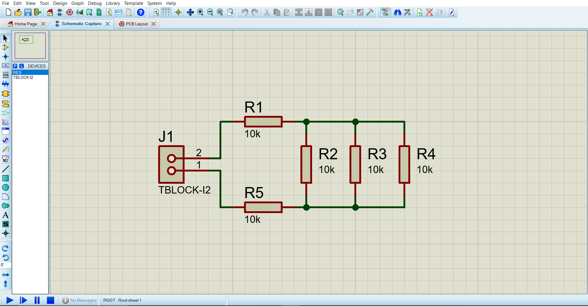
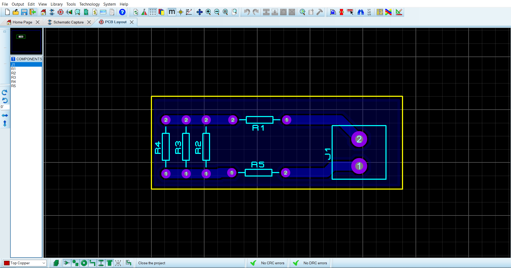
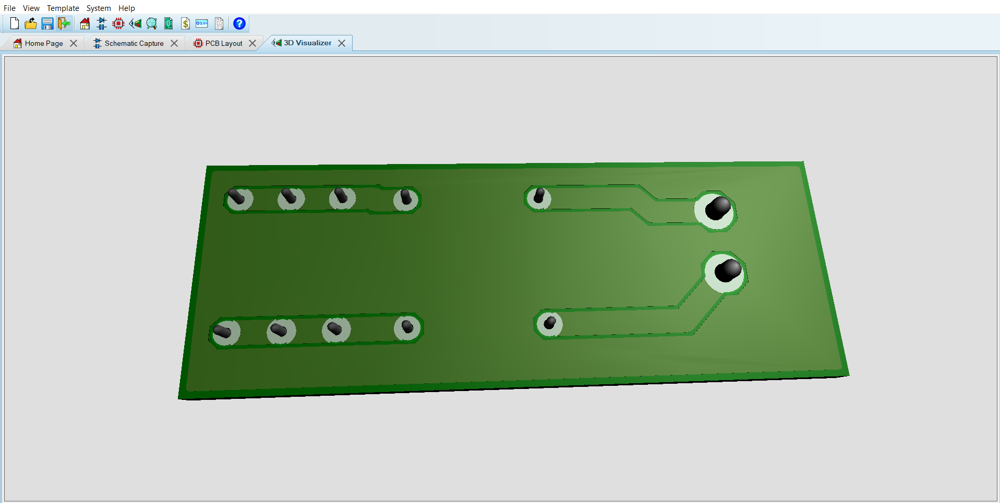
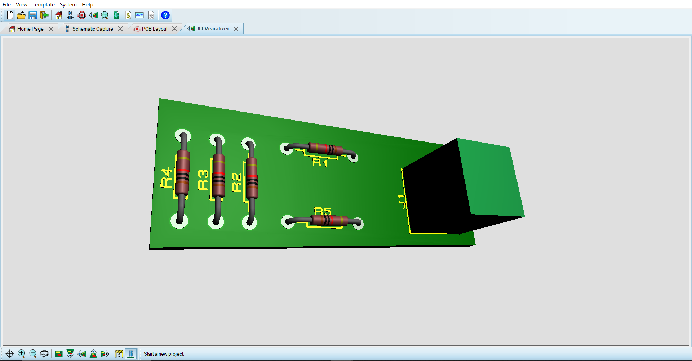

# Design 1 — Réseau de résistances

## Présentation

Ce projet Proteus représente un réseau de cinq résistances de 10 kΩ : R1 et R5 sont placées en série sur les deux lignes d'entrée, tandis que R2, R3 et R4 relient ces deux lignes en parallèle. Le dossier contient le schéma, le projet Proteus et les vues du circuit imprimé.

## Fichier du projet

- `Design 1.pdsprj` — projet à ouvrir avec Proteus 8 Professional.

## Captures

### Schéma électrique

### Routage du circuit imprimé

### Vues 3D du circuit imprimé

