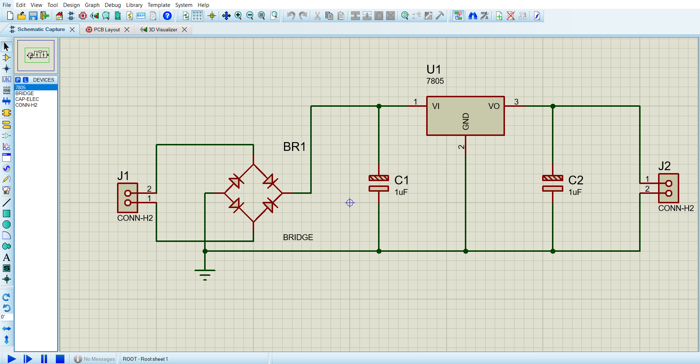
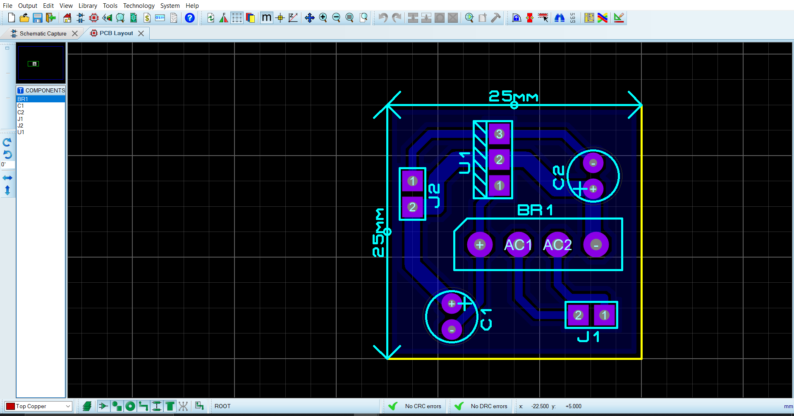
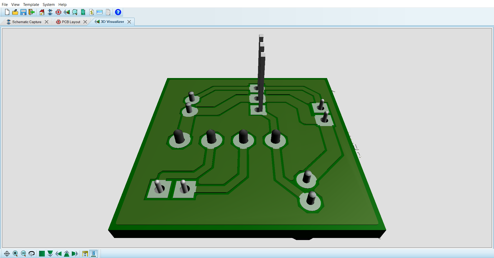
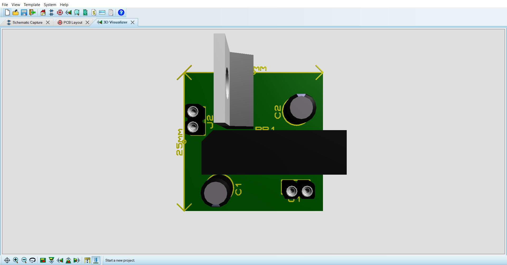
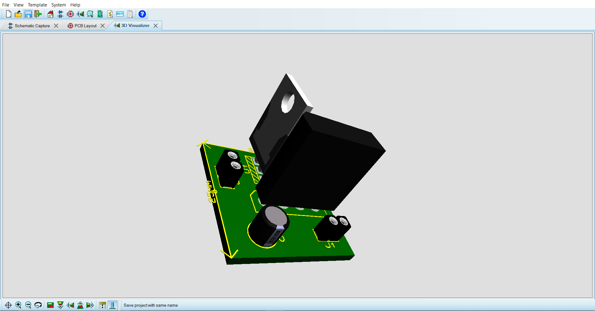

# Design 2 — Alimentation régulée 5 V

## Présentation

Ce projet Proteus illustre une alimentation composée d'un pont redresseur, de condensateurs de filtrage et d'un régulateur 7805. Le schéma prévoit des connecteurs d'entrée et de sortie. Les captures montrent également le routage et des aperçus 3D du circuit imprimé.

## Fichier du projet

- `Design 2.pdsprj` — projet à ouvrir avec Proteus 8 Professional.

## Captures

### Schéma sous ISIS

### Circuit imprimé

### Aperçus 3D

