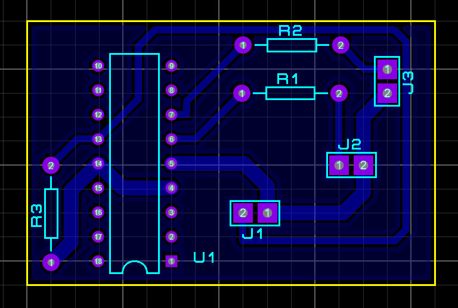
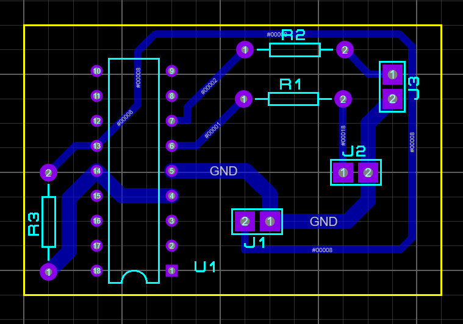
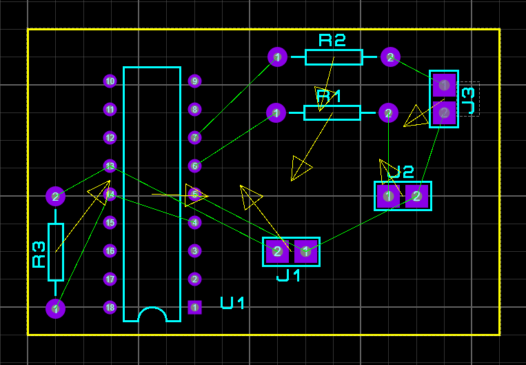
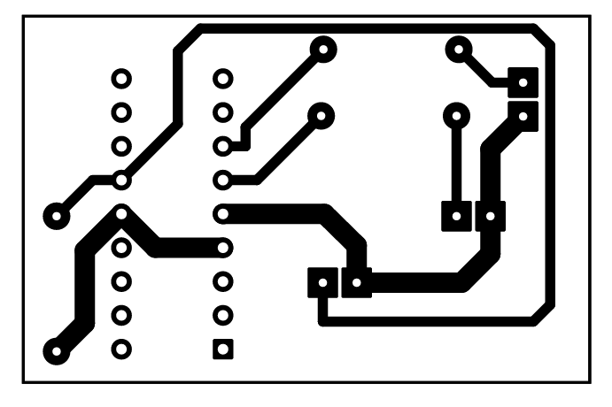
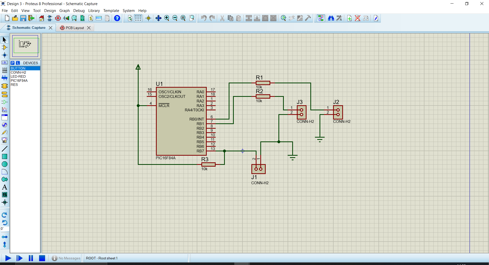
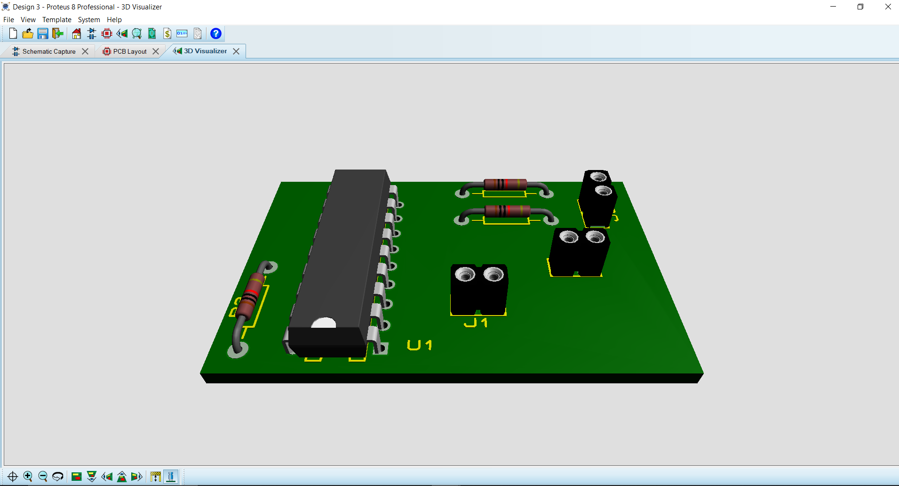
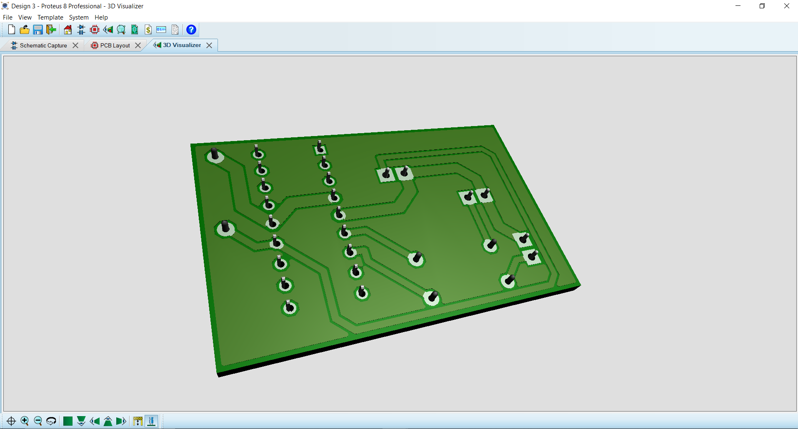

# Design 3 — Montage à microcontrôleur PIC16F84A

## Présentation

Ce projet Proteus est construit autour d'un microcontrôleur PIC16F84A. Le dossier comprend le fichier projet et plusieurs captures du schéma et de sa conception dans Proteus.

## Fichier du projet

- `Design 3.pdsprj` — projet à ouvrir avec Proteus 8 Professional.

## Captures

Les images ci-dessous présentent les différentes captures disponibles pour ce design.

