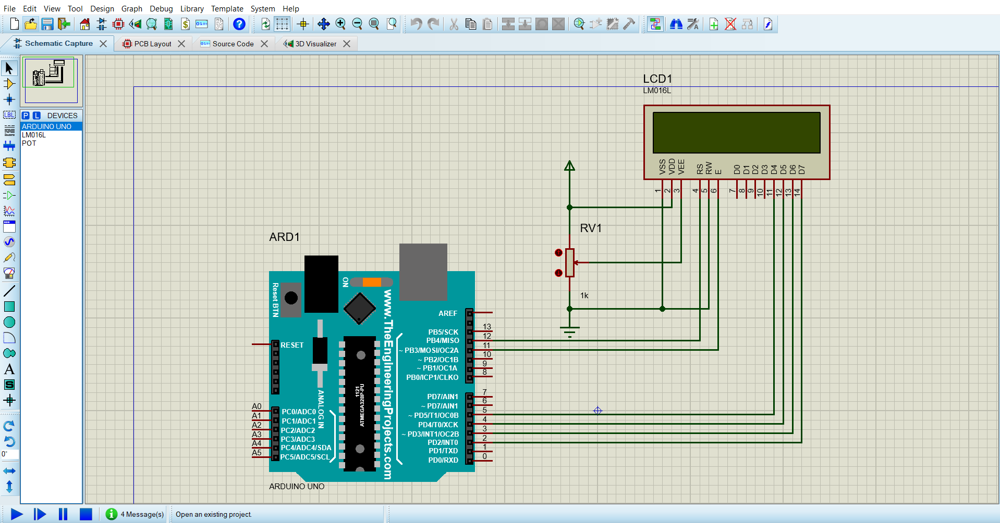
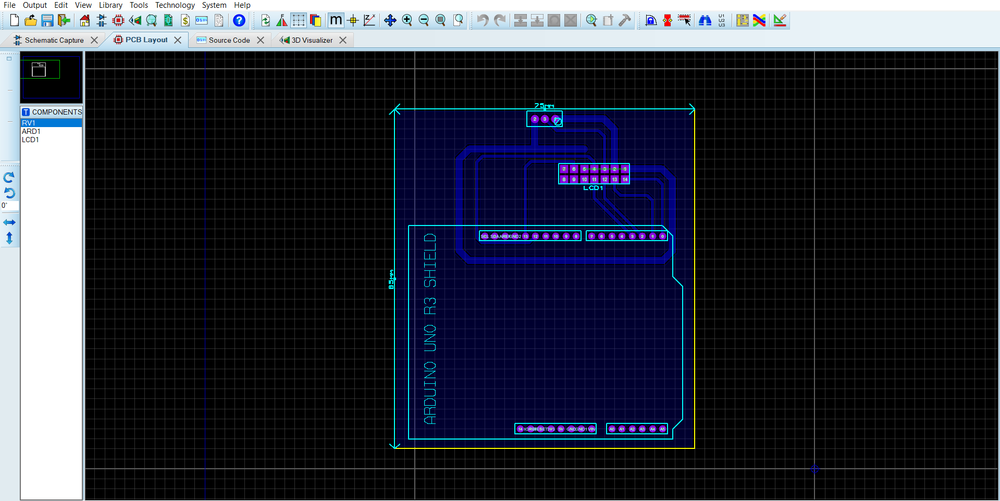
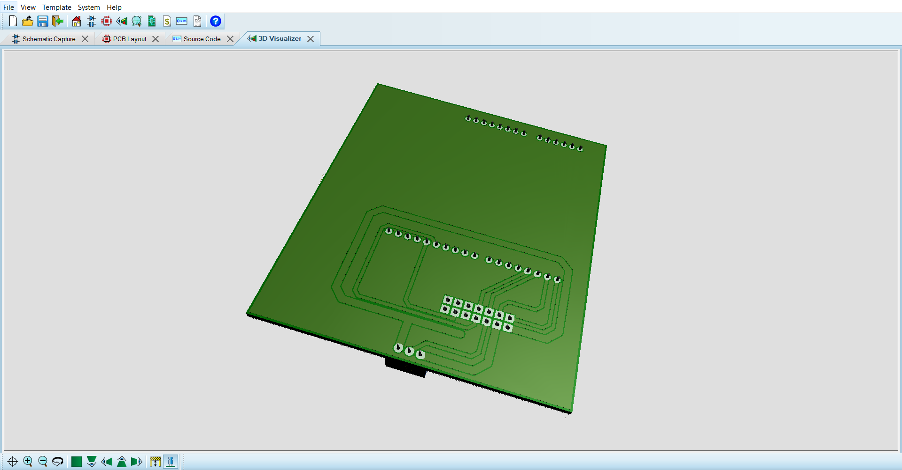
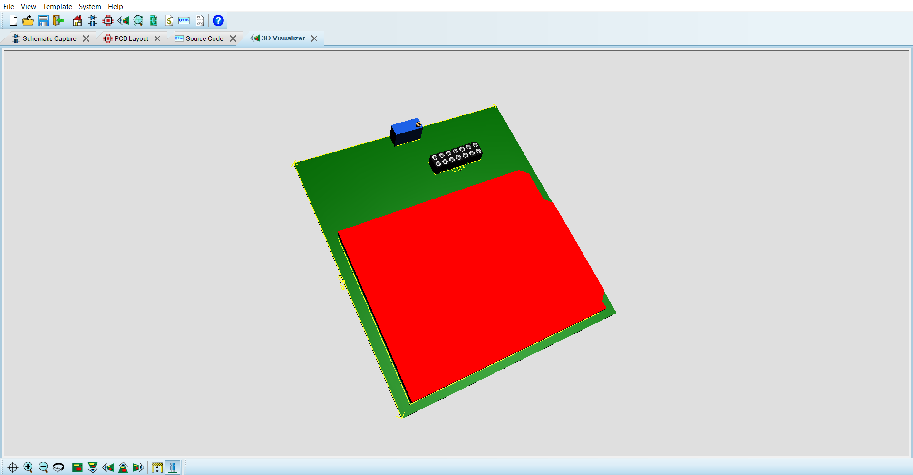

# Design 4 — Interface Arduino Uno et écran LCD

## Présentation

Ce projet Proteus relie une carte Arduino Uno à un écran LCD LM016L. Un potentiomètre est également présent dans le schéma. Les captures montrent le schéma, la carte et des vues de conception.

## Fichier du projet

- `Design 4.pdsprj` — projet à ouvrir avec Proteus 8 Professional.

## Captures

### Schéma

### Circuit imprimé et vues complémentaires

