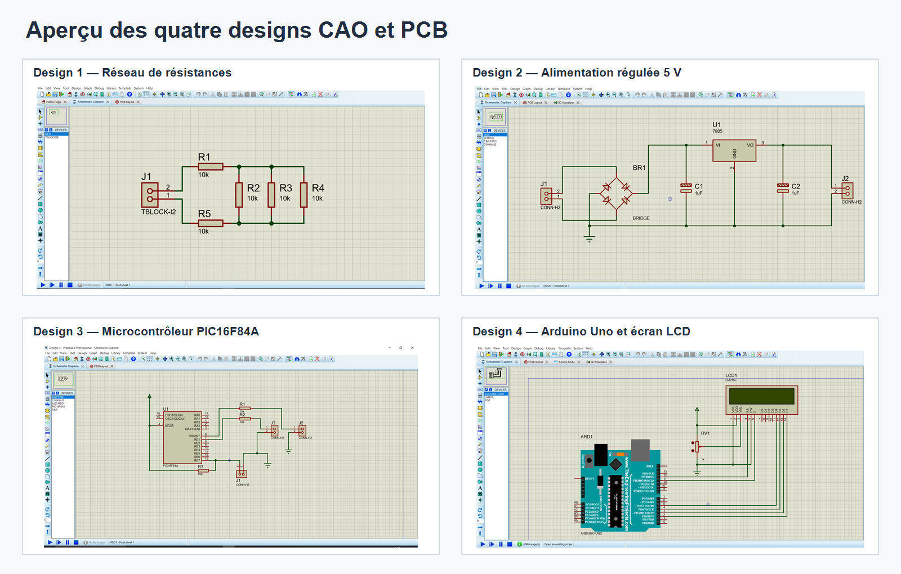

# Conception CAO et PCB

Ce dépôt regroupe quatre projets réalisés avec Proteus 8 Professional. Chaque design est conservé dans sa propre branche afin de pouvoir le consulter indépendamment.

| Design | Description | Branche |
| --- | --- | --- |
| Design 1 | Réseau de résistances, schéma et réalisation du PCB | [design-1](https://github.com/Bejaoui-Fedi/CAD-and-PCB-Design/tree/design-1) |
| Design 2 | Alimentation régulée autour d'un pont de diodes et d'un 7805 | [design-2](https://github.com/Bejaoui-Fedi/CAD-and-PCB-Design/tree/design-2) |
| Design 3 | Montage autour d'un microcontrôleur PIC16F84A | [design-3](https://github.com/Bejaoui-Fedi/CAD-and-PCB-Design/tree/design-3) |
| Design 4 | Interface Arduino Uno avec écran LCD | [design-4](https://github.com/Bejaoui-Fedi/CAD-and-PCB-Design/tree/design-4) |

Chaque branche contient le fichier projet `.pdsprj` et les captures d'écran correspondantes. Ouvrir le projet avec Proteus 8 Professional pour le modifier.
